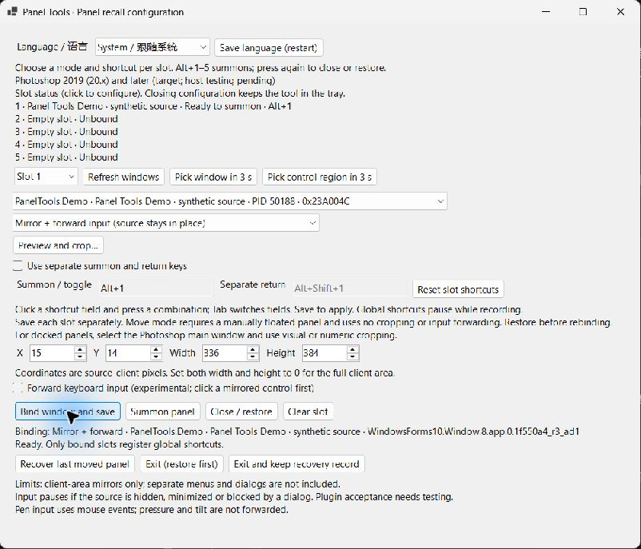
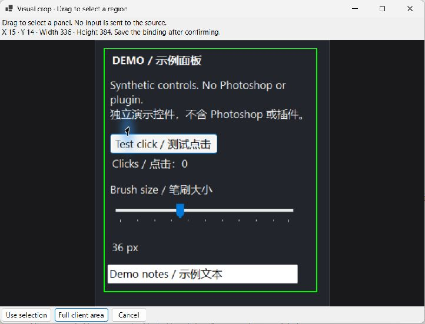
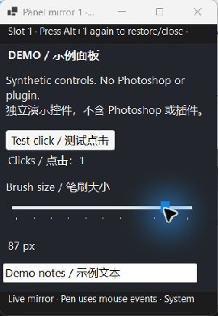
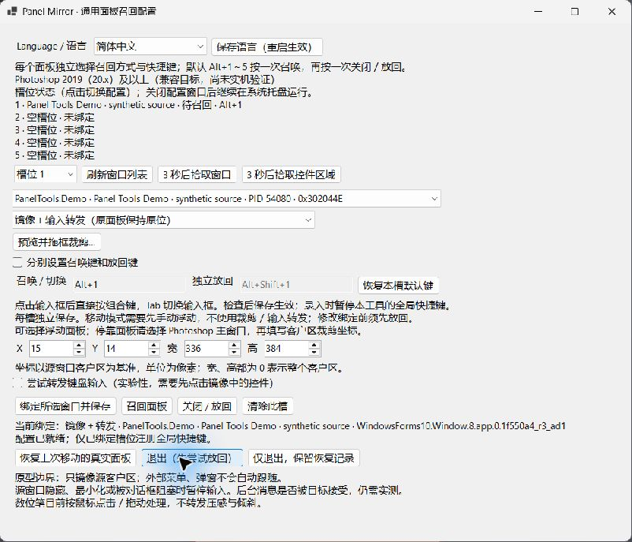

# Photoshop Panel Tools

[English](README.md) · [简体中文](README.zh-CN.md)

[](https://github.com/kiochan/photoshop-panel-tools/actions/workflows/ci.yml) [](LICENSE)

**Bring a panel to your pointer, use it, and return to your canvas.**

Panel Tools is a Windows companion for Photoshop workflows. Five slots let you choose independently between a live window mirror and temporarily moving a real floating panel. Default **Alt+1–5** shortcuts toggle each slot open/closed or recalled/restored.

[Download and help](https://kiochan.one/releases/panel-tools) · [Verification record](docs/VERIFICATION.md) · [Report a problem](https://github.com/kiochan/photoshop-panel-tools/issues/new/choose)

> Development trial. Photoshop 2019 (20.x) and later are compatibility targets, with 2019, 2020 and 2025 prioritized. **Photoshop and third-party plugin behavior have not been runtime-verified.** The screenshots below show the actual interface using an independent synthetic demo window, with isolated demo settings.



## Supported panels and manual cropping

**Only independent floating Photoshop panel windows are supported in both modes.** Float the panel manually before binding. Photoshop's main window, document windows and docked regions are blocked. The conservative window-class/Photoshop-host checks may also reject some third-party floating panels; an unsupported panel is not automatically accepted just because it looks like a panel.

Use **Preview and crop…** to drag any rectangle inside the selected floating panel's client area. The crop is saved exactly as selected, without snapping to another control. A width and height of 0 uses the full client area. Moving the same floating window updates the mirror coordinates; partial crops pause if its client size changes, so crop and bind again. Re-select the crop whenever the panel's internal layout or active tab changes.

Docking, closing/recreating, hiding, minimizing or disabling the source pauses input. Docking/undocking is not supported as a tracking workflow; float and explicitly rebind the panel. Existing coordinate-only bindings require rebinding before input can be enabled. Unsupported old main-window/docked bindings cannot be opened. Layout changes pause input until stable for at least 300 ms; each forwarded message revalidates the native geometry and identity, rejecting snapshots older than 500 ms.

This is native window tracking, not content recognition. A panel may redraw or switch tabs inside an unchanged window without exposing a detectable layout change. Manual cropping does not identify the controls in that region. Posted messages remain asynchronous and may be ignored by plugins; no guarantee of zero misclicks or Photoshop compatibility is made. Cancellation is sent only to the original stamped target without posting a coordinate-bearing mouse-up into uncertain geometry; plugins that ignore cancellation may need manual recovery. No pointer movement, injection or automatic switch to moving mode is used.

The gallery shows the earlier **0.3.0 synthetic demonstration**, not this version's support restrictions or Photoshop verification. See the [verification record](docs/VERIFICATION.md) for current static/build evidence.

## Choose the right mode

|                               | Mirror + forward input                                                              | Move a real floating panel                                                   |
| ----------------------------- | ----------------------------------------------------------------------------------- | ---------------------------------------------------------------------------- |
| What appears near the pointer | A live DWM image of the source client area                                          | The original window                                                          |
| Original layout               | Source stays in place                                                               | Original position and size are recorded before moving                        |
| Docked panel                  | Unsupported; float the panel manually first                                         | Unsupported; float the panel manually first                                  |
| Interaction                   | Background mouse messages; acceptance depends on the plugin                         | The panel handles its own normal interaction                                 |
| Pen behavior                  | Mouse-compatible events only; no native pressure, tilt, eraser or Wintab forwarding | Handled by the original panel/driver; Photoshop behavior still needs testing |
| Menus and dialogs             | Separate windows are not automatically mirrored                                     | Handled by the source application                                            |
| Finish                        | Press the slot key again to close the mirror                                        | Press the slot key again and verify restoration                              |

Each slot explicitly chooses its mode. Mirror mode never silently falls back to moving the real window. It does not move the system pointer, use `SendInput` or inject into Photoshop.

## Download and first setup

1. Download the complete Windows x64 ZIP from the [official page](https://kiochan.one/releases/panel-tools). **dev** contains the latest development build; **prod** is a separate channel. Each channel keeps only its latest package.
2. Extract the whole ZIP into a writable local folder. Keep `helper/`, `CSXS/`, the launcher files and notices together.
3. Run `helper/PanelMirror.exe`. The .NET 8 runtime is bundled; Photoshop does not need to be open just to configure the tool.
4. Manually float the Photoshop panel. Choose a slot, then its independent panel window. **Pick window in 3 s** reads the window under your pointer without clicking or moving it.
5. Select a mode and shortcut. For mirror mode, use **Preview and crop…** to select the region, or enter source-client coordinates. A width and height of 0 means the full client area. **Use selection** fills the fields; **Bind window and save** applies them.
6. Place your pointer where you want the panel and press **Alt+1** (or the configured shortcut). Press again to close or restore.

Keep the floating source visible and not minimized. A control-region picker may identify only a single button; inspect the preview before saving. Re-crop after internal layout changes; after docking, float and rebind.



## Daily use

- **Five independent slots:** separate modes, crops, summon keys and optional return keys. Only bound slots register shortcuts. Duplicate combinations are rejected; Windows registration failures are reported.
- **Mirror size memory:** resize a mirror manually to save its client size in logical pixels. Future summons reuse it; first use fits the source region to the screen. Mixed-DPI behavior still needs broader testing.
- **Slot overview:** see ready, offline, ambiguous, paused and recovery states without opening every slot.
- **Tray operation:** closing configuration keeps the tool running. Double-click the tray icon, choose **Open configuration**, or run the helper again to recall configuration.
- **Tray menu:** pause/resume shortcuts, close all mirrors, restore the real panel, or exit after attempting restoration. Windows notification settings determine whether failure balloons are displayed.

The mirror below is a genuine capture after the synthetic button counted a click and the slider changed from 36 to 87 px. That confirms these demo controls accepted the forwarded messages; it does not establish acceptance by any Photoshop plugin.



## Language

The native interface, tray menu, crop editor, status and recovery messages support **English** and **Simplified Chinese**. Choose **Language / 语言**, save the preference, then exit and reopen the tool. **System** chooses Chinese on Chinese systems and English otherwise. Existing settings without a language field follow the system automatically.

The optional CEP launcher has its own immediate language selector. Its browser preference is independent of the native helper preference. The standalone .NET Framework prototype follows the system language.



## Restoration and local data

Move mode preserves an identity-checked recovery journal **before the first move** and verifies the returned position and size before completing restoration. Only one real panel is away from its origin at a time; mirrors can remain independent.

If restoration fails, keep the record and choose **Recover last moved panel**. If you must stop, choose **Exit and keep recovery record**. Do not delete the record or run a second moving tool against the same window. Recovery will not automatically choose a different window when identity cannot be verified.

| Local data                  | Default location                           |
| --------------------------- | ------------------------------------------ |
| Unified settings            | `%LOCALAPPDATA%\PanelMirror\settings.json` |
| Shared real-panel recovery  | `%LOCALAPPDATA%\PanelRecall\return.json`   |
| Optional prototype settings | `%LOCALAPPDATA%\PanelRecall\settings.json` |

No automatic update installer is implemented. See [PRIVACY.md](PRIVACY.md) for data handling. Back up settings before troubleshooting; do not publish recovery files or personal window titles in issue reports.

## Troubleshooting

| Symptom                                     | What to check                                                                                                                                                               |
| ------------------------------------------- | --------------------------------------------------------------------------------------------------------------------------------------------------------------------------- |
| Shortcut does nothing                       | Bind and save the slot, resume shortcuts from the tray, then check the slot's registration status. Choose a different combination if another application owns it.           |
| Source not found after restart              | Open the source. Titles may change; refresh and explicitly rebind. Ambiguous matches are not chosen automatically.                                                          |
| Mirror displays but controls do not respond | Confirm the source is enabled and visible. Try a harmless control. A delivered message does not prove acceptance. You can explicitly choose move mode for a floating panel. |
| Crop is wrong                               | Reopen the preview after source-size or internal panel changes. Coordinates refer to the source client area, not the screen.                                                |
| Configuration seems to have closed          | It remains in the tray. Reopen from there or launch the helper again. Use the explicit Exit action to stop it.                                                              |
| Real panel cannot return                    | Preserve the recovery record; use recovery and read the reported reason. Do not rebind an unresolved moved panel.                                                           |
| CEP cannot find the helper                  | Extract the complete ZIP again. CEP installation is optional; run `helper/PanelMirror.exe` directly.                                                                        |

## Compatibility and verification

- Windows x64; the packaged native tool includes .NET 8. Supporting an older Photoshop version does not imply support for every Windows version from that era.
- Optional CEP launcher: ES5 syntax / CEP 9 baseline, Photoshop host range `[20.0,99.9]`. The broad upper bound is not a promise of support for future hosts without CEP.
- Source hiding/minimization, layout changes, modal dialogs, multiple Photoshop instances and mixed DPI need particular care.
- Static checks, translation/launcher tests, zero-warning builds and isolated desktop demo checks are described in [docs/VERIFICATION.md](docs/VERIFICATION.md). The full host matrix is in [COMPATIBILITY.md](COMPATIBILITY.md).

## Build and contribute

Requirements: Windows x64, Node.js 22+, npm and .NET SDK 8. The optional prototype also needs the Windows .NET Framework C# compiler.

```powershell
npm ci
npm run privacy:check
npm run check
npm run package
```

Outputs: `dist/panel-tools/`, `artifacts/panel-tools-<version>.zip` and its `.sha256` file. Builds do not install extensions or start Photoshop/native helpers. Both native builds treat warnings as errors; the optional prototype enforces C# 5.

| Source                              | Responsibility                                                              |
| ----------------------------------- | --------------------------------------------------------------------------- |
| `src/PanelMirror/`                  | .NET 8 WinForms tool                                                        |
| `src/PanelRecall/`                  | Shared recovery engine and optional prototype                               |
| `shared/windows-native/`            | C# 5 compatible helpers and translation catalog                             |
| `cep/`                              | Optional ES5 launcher                                                       |
| `src/PanelTools.Demo/`              | Source-only synthetic demonstration harness; not shipped in the product ZIP |
| `scripts/`, `docs/`, `screenshots/` | Builds, verification, documentation and reviewed real screenshots           |

The root `package.json` owns the version. Successful upstream dev/prod pushes publish only Panel Tools to the matching latest-only website channel. PR/fork jobs do not receive publication credentials. See [BUILDING.md](BUILDING.md), [CONTRIBUTING.md](CONTRIBUTING.md) and [SECURITY.md](SECURITY.md).

MIT licensed. Photoshop and third-party plugins are not included. Preserve [LICENSE](LICENSE) and [THIRD_PARTY.md](THIRD_PARTY.md) when distributing packages.
