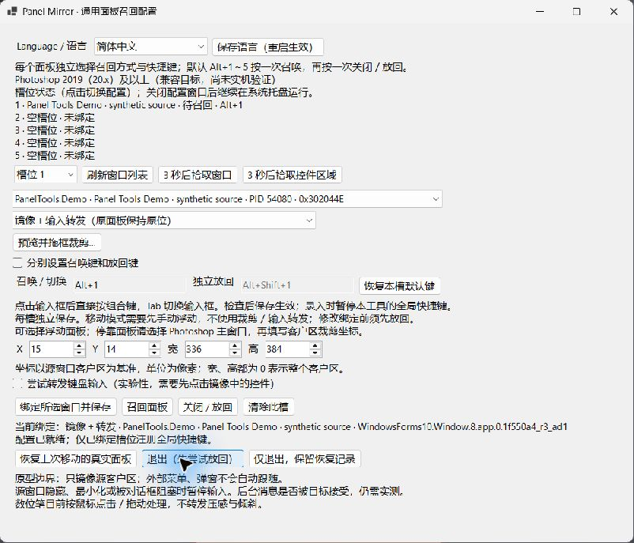
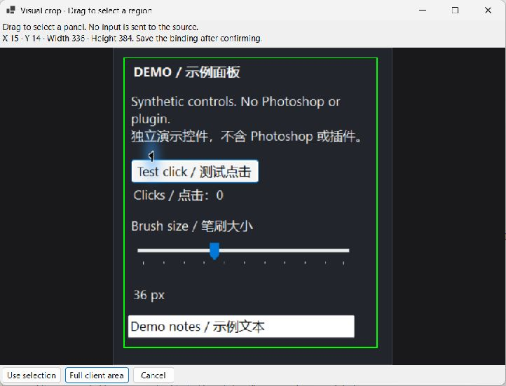
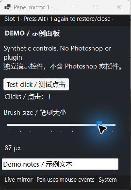
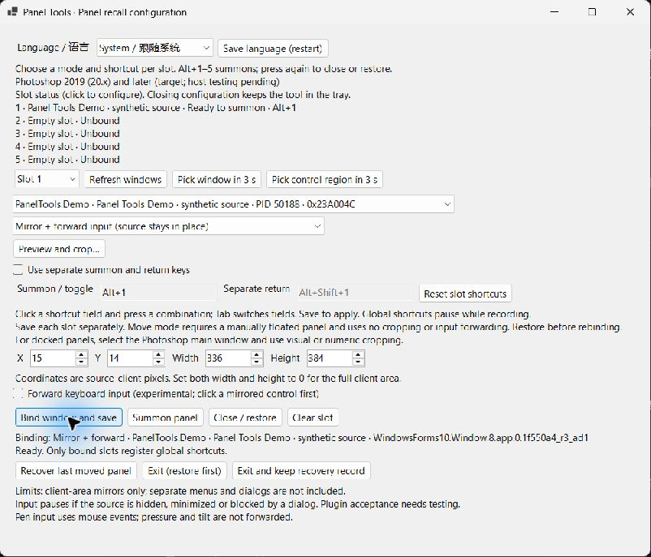

# Photoshop Panel Tools

[English](README.md) · [简体中文](README.zh-CN.md)

[](https://github.com/kiochan/photoshop-panel-tools/actions/workflows/ci.yml) [](LICENSE)

**把面板召到指针旁，用完放回，继续画画。**

Panel Tools 是配合 Photoshop 工作流使用的 Windows 工具。五个槽位可以分别选择实时镜像或移动真实浮动面板。默认 **Alt+1～5** 按一次召唤，再按一次关闭镜像或放回原面板。

[下载与帮助](https://kiochan.one/releases/panel-tools) · [验证记录](docs/VERIFICATION.md) · [反馈问题](https://github.com/kiochan/photoshop-panel-tools/issues/new/choose)

> 当前为开发试用版。兼容目标是 Photoshop 2019（20.x）及以上，优先验收 2019、2020、2025。**Photoshop 和第三方插件的实际运行兼容性仍未验证。** 下方截图来自真实工具界面，使用独立合成演示窗口和隔离配置，不包含 Photoshop 或第三方插件。



## 两种方式，如何选择

|                | 镜像＋输入转发                                        | 移动真实浮动面板                         |
| -------------- | ----------------------------------------------------- | ---------------------------------------- |
| 指针旁出现什么 | 源客户区的实时 DWM 画面                               | 原来的真实窗口                           |
| 原来的布局     | 源面板保持原位                                        | 移动前记录原位置、尺寸和窗口身份         |
| 停靠面板       | 选择 Photoshop 主窗口，再裁剪需要的客户区             | 需要先手动拖成浮动窗口                   |
| 如何交互       | 转发后台鼠标消息，是否接受取决于插件                  | 由原面板处理正常交互                     |
| 数位笔         | 仅鼠标兼容事件，不转发原生压感、倾斜、橡皮擦或 Wintab | 由原面板和驱动处理，Photoshop 中仍需实测 |
| 菜单与弹窗     | 独立窗口不会自动镜像                                  | 由源程序正常处理                         |
| 用完之后       | 再按槽位键关闭镜像                                    | 再按槽位键放回，并确认恢复结果           |

每个槽位明确选择方式。镜像不会静默切换成移动模式，也不通过移动真实指针、`SendInput` 或进程注入来实现后台输入。

## 下载与首次绑定

1. 从[官方下载页](https://kiochan.one/releases/panel-tools)取得完整 Windows x64 ZIP。**dev** 是最新开发构建，**prod** 是独立渠道；每个渠道只保留最新包。
2. 将整个 ZIP 解压到可写的本地文件夹，保留 `helper/`、`CSXS/`、启动页和许可声明。
3. 运行 `helper/PanelMirror.exe`。包内已带 .NET 8 运行时；单独打开配置不需要启动 Photoshop。
4. 选择槽位和源窗口。**3 秒后拾取窗口**会读取指针下的窗口，不点击或移动目标。
5. 选择方式和快捷键。镜像方式可用**预览并拖框裁剪…**选区，也可填写源客户区坐标。宽、高都为 0 表示完整客户区。**使用此区域**只回填坐标，随后点击**绑定所选窗口并保存**才生效。
6. 将指针放在希望出现面板的位置，按 **Alt+1**（或自定义键）召回，再按一次关闭／放回。

镜像源需要保持显示且未最小化。拾取控件区域可能只命中一枚按钮，保存前请检查预览；Photoshop 工作区布局变化后需要重新裁剪。



## 日常使用

- **五槽独立配置**：方式、裁剪、召唤键和可选的独立放回键分别保存。仅已绑定槽位注册快捷键；重复键和系统注册失败会提示。
- **记住镜像大小**：手动调整镜像尺寸后，按逻辑像素保存；以后召回沿用该槽位的大小。首次使用按源区域适配屏幕，混合 DPI 仍需更多验证。
- **槽位总览**：直接查看待召回、离线、匹配不唯一、暂停和待恢复状态。
- **托盘常驻**：关闭配置窗口后工具继续运行。双击托盘图标、选择**打开配置**，或再次运行助手，都可唤回配置。
- **托盘操作**：暂停／恢复快捷键、关闭所有镜像、放回真实面板和退出。失败通知是否显示受 Windows 通知设置影响。

下图是在合成窗口中点击成功、滑块从 36 变到 87 px 后取得的真实镜像截图。这只能证明这些演示控件接受了转发消息，不能据此推断某个 Photoshop 插件也能接受。



## 界面语言

原生界面、托盘、裁剪编辑器、状态和恢复提示支持**简体中文与英语**。在 **Language / 语言** 中选择，保存后退出并重新打开工具。**跟随系统**在中文系统上使用中文，其他系统上使用英语。旧配置没有语言字段时会自动跟随系统。

可选 CEP 启动器的语言选择即时生效，与原生助手的语言偏好独立保存。可选 .NET Framework 原型跟随系统语言。



## 恢复与本地数据

移动模式在**第一次移动前**保存经过身份校验的恢复记录，放回后确认位置和尺寸，再完成恢复。同一时刻只移动一个真实面板，各镜像槽位可以独立使用。

恢复失败时保留记录，使用**恢复上次移动的真实面板**重试。必须退出时，可选择**仅退出，保留恢复记录**。不要删除恢复文件，也不要让另一款移动工具同时操作同一窗口；身份无法确认时，不会自动改动另一个同名窗口。

| 数据                 | 默认位置                                   |
| -------------------- | ------------------------------------------ |
| 统一工具配置         | `%LOCALAPPDATA%\PanelMirror\settings.json` |
| 共享真实面板恢复记录 | `%LOCALAPPDATA%\PanelRecall\return.json`   |
| 可选原型配置         | `%LOCALAPPDATA%\PanelRecall\settings.json` |

目前没有客户端自动更新安装器。数据处理见 [PRIVACY.md](PRIVACY.md)。排查配置问题前先备份；反馈问题时不要上传恢复记录或包含个人窗口标题的截图。

## 常见问题

| 现象                 | 检查方法                                                                                         |
| -------------------- | ------------------------------------------------------------------------------------------------ |
| 按键没反应           | 先绑定并保存，检查托盘是否暂停快捷键，再看槽位注册状态；被其他软件占用时换组合键。               |
| 重启后找不到源       | 打开源窗口并刷新。标题变化后明确重新绑定；多个同名同类窗口不会自动选择。                         |
| 镜像能看，点了没反应 | 确认源窗口可操作且未隐藏，先试无害控件。投递成功不等于插件接受；浮动面板可由你明确改选移动方式。 |
| 裁剪错位             | 源尺寸或工作区改变后重新预览。坐标以源客户区为基准，不是屏幕坐标。                               |
| 配置窗口关掉了       | 工具还在托盘中。托盘或再次启动可唤回，真正停止请用明确的退出操作。                               |
| 真实面板放不回       | 保留记录，使用恢复操作查看失败原因。未解决前不要重绑这个已移动面板。                             |
| CEP 找不到助手       | 重新完整解压 ZIP。CEP 不是必需的，也可直接运行 `helper/PanelMirror.exe`。                        |

## 兼容与验收

- Windows x64，正式包自带 .NET 8。兼容旧 Photoshop 不代表兼容其历史上所有 Windows 版本。
- 可选 CEP 启动器保持 ES5／CEP 9 基线，宿主范围 `[20.0,99.9]`。上界较宽，不代表未来不提供 CEP 的宿主也能运行。
- 源隐藏／最小化、布局变化、模态弹窗、多个 Photoshop 实例和混合 DPI 需要重点验收。
- 已完成的静态、翻译／启动器测试、零警告编译和独立桌面演示检查见[验证记录](docs/VERIFICATION.md)；Photoshop 完整矩阵见 [COMPATIBILITY.md](COMPATIBILITY.md)。

## 从源码构建

要求：Windows x64、Node.js 22+、npm、.NET SDK 8。可选原型另外需要 Windows .NET Framework C# 编译器。

```powershell
npm ci
npm run privacy:check
npm run check
npm run package
```

产物为 `dist/panel-tools/`、`artifacts/panel-tools-<version>.zip` 和对应 `.sha256`。构建不会安装扩展或启动 Photoshop／原生助手。两套原生构建均把警告视为错误，可选原型明确按 C# 5 编译。

| 目录                                | 用途                                 |
| ----------------------------------- | ------------------------------------ |
| `src/PanelMirror/`                  | .NET 8 WinForms 主工具               |
| `src/PanelRecall/`                  | 共享恢复引擎和可选原型               |
| `shared/windows-native/`            | C# 5 兼容辅助代码与翻译目录          |
| `cep/`                              | 可选 ES5 启动器                      |
| `src/PanelTools.Demo/`              | 源码专用合成演示程序，不进入产品 ZIP |
| `scripts/`、`docs/`、`screenshots/` | 构建、验证、文档和审阅过的真实截图   |

根 `package.json` 管理版本。上游 dev／prod 成功推送只发布 Panel Tools 到对应网站渠道，PR／fork 不获取发布凭证。详见 [BUILDING.md](BUILDING.md)、[CONTRIBUTING.md](CONTRIBUTING.md)、[SECURITY.md](SECURITY.md)。

采用 MIT 许可证，不含 Photoshop 和第三方插件。分发包须保留 [LICENSE](LICENSE) 和 [THIRD_PARTY.md](THIRD_PARTY.md)。
