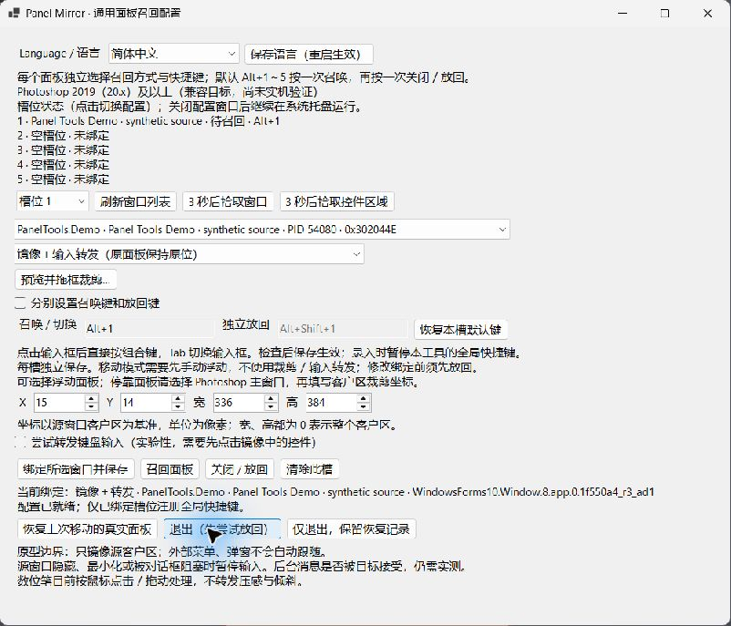
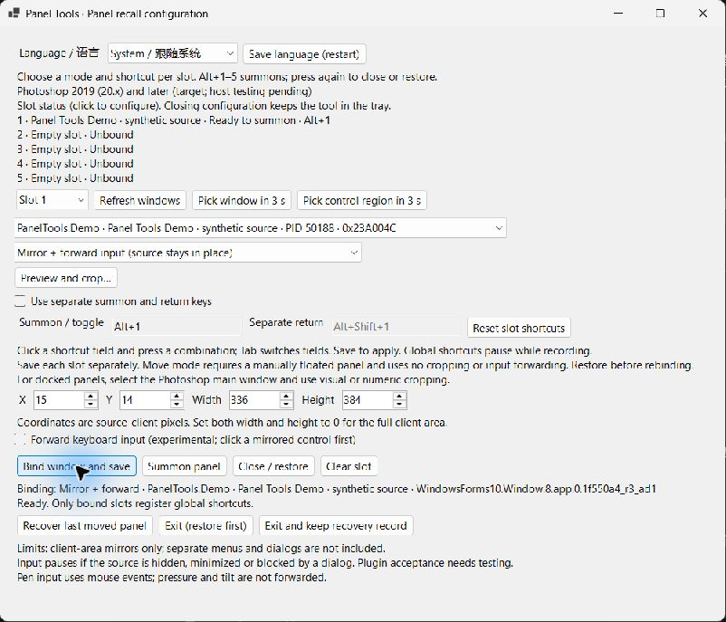
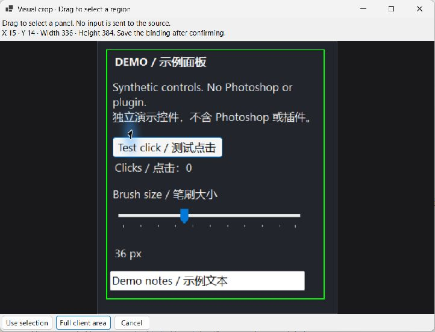
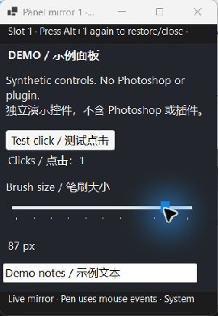

---

{
"slug": "panel-tools",
"title": "Panel Tools",
"summary": "Bring a Photoshop plugin panel close to your pointer, with a per-panel choice of a live mirror or the real floating window.",
"status": "trial",
"compatibility": ["Independent floating Photoshop panels only; docked regions unsupported", "Windows x64", "Photoshop 2019 (20.x) and later: compatibility target, not runtime certification", "Native pen pressure, tilt and pure Wintab forwarding are not implemented in mirror mode"]
}
---

## New in 0.4.0 / 本次更新

- **Independent floating Photoshop panels only, in both modes.** Float a panel manually before binding. Main/document windows and docked regions are blocked. Conservative identification may reject some third-party panels.
- **两种模式都仅支持独立浮动的 PS 面板。** 主窗口、文档及停靠区域禁止使用，部分无法可靠识别的第三方面板也可能不支持。
- Drag a manual crop inside the floating panel; its rectangle is preserved exactly. Position changes update the mirror. Partial crops pause after client-size changes; re-crop and bind again. Internal layout/tab changes also require manual review and re-selection.
- 保留手动框选区域；同一浮动窗口移动时跟随。部分裁剪遇到尺寸变化时暂停；内部重排、切换标签后请重新框选。停靠或窗口重建后需手动浮动并重新绑定。
- Native identity/layout guards pause uncertain input and reject stale snapshots. Existing coordinate-only bindings need rebinding. These guards do not recognize content redrawn inside the same window and cannot guarantee zero misclicks or plugin acceptance of background messages.
- No Photoshop or native-helper runtime tests were performed for 0.4.0. Static/build results are recorded in the repository verification document; compilation is not Photoshop validation.

## Interface screenshots / 界面截图

These are historical 0.3.0 real window captures using an independent synthetic source, not current UI or Photoshop/plugin compatibility evidence. 以下为独立合成面板的真实界面截图，不是 Photoshop 或插件兼容性证明。

## Panel recall features

- **Visual crop editor:** drag a rectangle on a live source-window preview, with numeric coordinates still available. Confirm the selection, then save the binding.
- **Per-slot mirror size memory:** manually resized mirrors keep their logical client size across sessions; new mirrors initially fit the source region to the screen.
- **Notification-area controls:** closing configuration keeps the helper running. Open configuration again from the tray or by launching the helper again; pause shortcuts, close mirrors or restore the real panel from the tray menu.
- **Slot status overview:** see missing or ambiguous windows, shortcut registration problems, mirror pauses and outstanding recovery. Failed operations also request a Windows notification.
- Shared native source compiles without warnings in .NET 8 and in the optional C# 5 / .NET Framework prototype. Both native builds now treat warnings as errors.

This remains a development trial. Selected paths passed isolated synthetic-window desktop checks; mixed-DPI and Photoshop/plugin compatibility still require runtime verification.

## Choose how each panel appears

- **Mirror and forward input:** keep the original panel in place and show its window image near your pointer. Acceptance of background input depends on the source plugin.
- **Move the real panel:** bring an already floating panel to your pointer and restore its original position afterwards. Docked panels need to be floated manually first.
- Set a different mode and shortcut for each of five slots. By default, press **Alt+1–5** once to summon and again to close or restore. Separate summon and return keys are optional.

## Install and get started

1. Download and extract the complete ZIP.
2. Run `helper/PanelMirror.exe`. The Windows x64 .NET runtime is bundled with this package.
3. Manually float a Photoshop panel, select its independent window, choose its mode and shortcut, then save the binding. A delayed pointer picker can help identify a window or client area.

The `CSXS` folder is an optional Photoshop CEP launcher. Its loading behavior depends on your Photoshop/CEP configuration; installing it is not necessary to run the native tool.

## Verification and limits

This is a development trial. Static checks, compilation and packaging are covered by CI. **Photoshop runtime behavior has not been verified** on the supported target versions.

Only conservatively identified independent floating Photoshop panels are supported. Docked regions, the Photoshop main window and document windows are blocked. Manual crops cannot detect content or tab changes; review and re-select them after internal rearrangement. Mirrors do not automatically include external menus and dialogs. Hidden or minimized source windows are unsupported. Moving mode does not automatically undock or re-dock panels. If a real window cannot be restored, retain the recovery record and use the recovery action before rebinding it.

Global shortcuts may conflict with other applications; change them in the configuration window. The tool does not move the system pointer or inject into Photoshop to make mirror input work.

## Open source

Panel Tools is now maintained in its own [MIT-licensed public repository](https://github.com/kiochan/photoshop-panel-tools). Its builds and dev/prod publication are independent of the Bailey workspace. Existing shortcuts, extension IDs and local recovery records are preserved.
